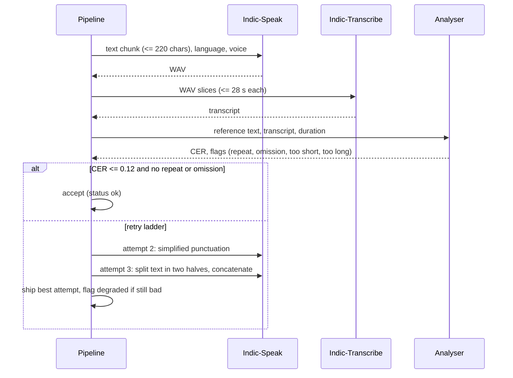
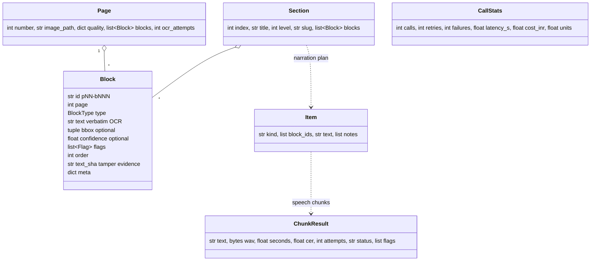
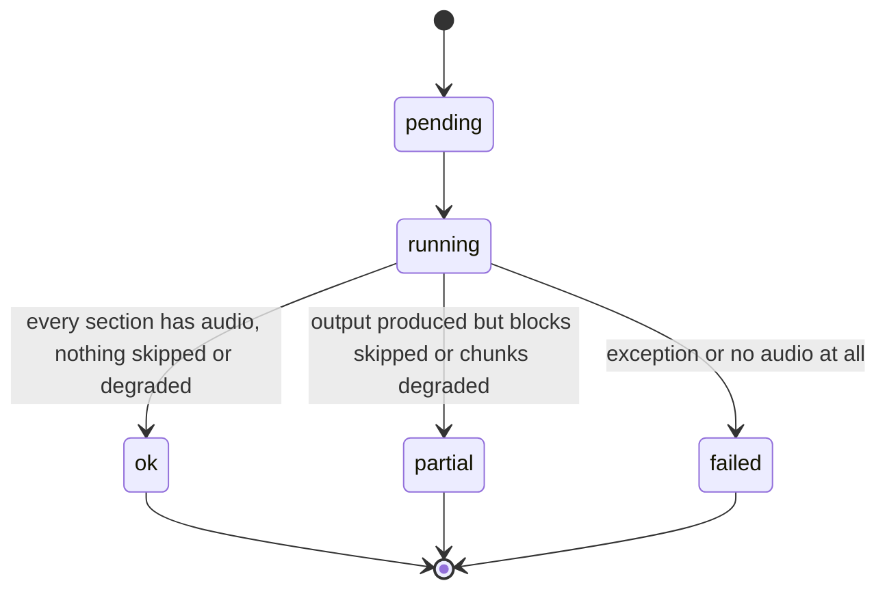
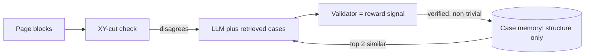

# Scanned Chapter to Narrated Lesson

**An agentic pipeline that turns a scanned textbook chapter into a clean source lesson, translated lessons, and verified, narrated audio, built only on Bodhan Indic models (OCR, translation, speech synthesis, speech recognition) with an LLM as a tightly fenced "brain".**

> Status: core application implemented; 51 offline tests pass. Live demo evidence, a short recording, and the Cookbook submission are still pending. Bodhan routes follow the published API reference; real model quality and runtime have not yet been measured.

---

## Interactive web reader

The repository also includes a static, browser-based reader for exploring a completed lesson run. It has a sample chapter with language switching, source/translation views, narration audio and scripts, a searchable section map, and the pipeline quality report. You can also open a pipeline output folder locally; files are read in your browser and are not uploaded.

The included sample is produced by simulated models. Its audio files are 300 Hz test tones, not speech, so playback is disabled in the web reader. Translations and metrics are illustrative only—not real Bodhan results. The reader makes no Bodhan or other model calls and needs no API keys.

```bash
python scripts/build_web.py
python -m http.server 8000 --directory dist
```

Run these commands from the repository root (the directory containing `render.yaml`), then open `http://localhost:8000`.

### Deploy the reader

- **GitHub Pages:** push to `main` or `master`, then set the repository’s Pages source to **GitHub Actions**. The workflow at `.github/workflows/deploy-pages.yml` builds and publishes the static reader.
- **Render:** create a Blueprint instance from `render.yaml`; it builds the static site without installing the model pipeline dependencies.

The reader is separate from the Python processing CLI; deploying it does not run OCR, translation, speech synthesis, or transcription.

---

## Table of contents

1. [Executive summary](#1-executive-summary)
2. [Problem statement and requirements](#2-problem-statement-and-requirements)
3. [Analysis: what makes this hard](#3-analysis-what-makes-this-hard)
4. [Solution overview and design principles](#4-solution-overview-and-design-principles)
5. [System architecture](#5-system-architecture)
6. [Build plan: Phases 1 to 6](#6-build-plan-phases-1-to-6)
7. [Algorithms in detail](#7-algorithms-in-detail)
8. [Agentic design](#8-agentic-design)
9. [Repository structure](#9-repository-structure)
10. [Installation](#10-installation)
11. [Configuration](#11-configuration)
12. [Usage](#12-usage)
13. [Output reference](#13-output-reference)
14. [Testing strategy](#14-testing-strategy)
15. [Live run checklist and evidence slots](#15-live-run-checklist-and-evidence-slots)
16. [Cost model](#16-cost-model)
17. [Performance, reliability and security](#17-performance-reliability-and-security)
18. [Limitations, assumptions and risks](#18-limitations-assumptions-and-risks)
19. [Future work](#19-future-work)
20. [Troubleshooting](#20-troubleshooting)
21. [Three-day execution plan and submission checklist](#21-three-day-execution-plan-and-submission-checklist)
22. [Appendix](#22-appendix)

---

## 1. Executive summary

**Input:** a scanned chapter (PDF or a folder of page images), in English or an Indian language.
**Output:** a source lesson, translated Markdown per target language, section audio, a full lesson with chapters, and `report.json` / `report.html` with quality checks, retries, latency and estimated cost.

What the system does that a naive "OCR, translate, TTS" script does not:

| Concern | How it is handled |
|---|---|
| LLM must never write Indian-language text | Enforced in code: the LLM returns block **ids only**; validators prove a pure permutation and unchanged OCR text hashes. English edits must keep numbers and LaTeX. |
| Garbled OCR | Scored per block; page re-OCRed at 2x when many blocks are doubtful; still-bad blocks are **withheld from translation and narration and listed** in `flagged.json`. |
| Running headers/footers (for example a website banner) | Removed by a **generic repetition rule** (edge text repeated on 40% or more of pages), never by matching a URL. |
| Two columns, boxed notes, cross-page paragraphs and tables | XY-cut reading order, LLM adjudication only on disagreement, deterministic joiner. |
| Tables, equations, figures | Equations copied verbatim; tables translated cell by cell; narration written in English (deterministic LaTeX-to-speech, verified table verbalisation, guarded figure description) then translated. |
| Terminology consistency | Per-chapter glossary (LLM extracts terms, Indic-Translate renders them once), placeholder locking, consistency reported. |
| TTS repeating or skipping text | Every chunk is transcribed back (Indic-Transcribe), scored with CER, analysed for insertions (repeat) and deletions (omission), and retried with a ladder. |
| Reruns and failures | Content-hash cache (no paid call repeated), per-language isolation, honest exit codes. |

---

## 2. Problem statement and requirements

### 2.1 Problem statement

Teachers and students in India often have textbook chapters only as scans. The goal is a system that, given a scanned chapter, produces a **clean source lesson**, **translated lessons** in the requested languages, and **narrated audio** that is correct enough to learn from, including tables, equations and figures, using only the Bodhan model family for the language-heavy work.

### 2.2 Interpretation of the brief

*(Verify against your copy of the assignment; this is the interpretation the design follows.)*

| # | Requirement | Where addressed |
|---|---|---|
| R1 | Use Bodhan models for OCR, translation, TTS and speech recognition; any other model for these tasks is an automatic fail | `clients/bodhan.py`, guard test `tests/guards/test_no_foreign_models.py` |
| R2 | An LLM may be used as the "brain" but must never write or rewrite Indian-language text | `layout/validators.py`, narration written in English then translated |
| R3 | Command-line entry point taking input, target languages and output folder | `cli.py` (`python -m bodhan_lesson`) |
| R4 | Markdown lesson per language preserving structure | `translate/`, `assemble/sections.py` |
| R5 | Audio per section plus full lesson with section markers, AI-generated labelling | `audio/mix.py`, `pipeline.py` |
| R6 | A report with timings, retries, quality and cost | `report/collector.py`, `report/html.py` |
| R7 | Handle hidden chapters: no special-casing of the demo | generic chrome rule, no hard-coded strings |
| R8 | Handle poor scans, multi-column pages, doubtful OCR | `ingest/quality.py`, `ocr/doubt.py`, `layout/` |
| R9 | Indian-language sources and an untested language should work | English pivot, unknown language codes pass through |
| R10 | Documentation: architecture, workflow, design notes, PR description | `docs/`, this README |
| R11 | Complete in one week (target: three days) | Section 21 |

### 2.3 Quality targets used by the report

| Target | Measured as |
|---|---|
| Structure survival | Ordered skeleton of headings (H), tables (T), equations (E) identical between source and translation |
| Numbers and LaTeX | 0 changed numbers or LaTeX spans in translated blocks (digits normalised across scripts) |
| Speech accuracy | Mean CER per section at most 0.12 |
| Loudness | -16 LUFS plus or minus 1 per section and for the full lesson |
| Honesty | Every skipped block, retry and degraded chunk is in `report.json` |

---

## 3. Analysis: what makes this hard

| Hard part | Failure mode if ignored | Design response |
|---|---|---|
| Reading order | Columns interleaved, sidebars in the middle of a paragraph | XY-cut on bounding boxes, LLM adjudication, validator fence |
| OCR noise | Garbage is translated and spoken confidently | Doubt scoring, 2x re-OCR, withholding, flagged report |
| Page chrome | "www... free material" narrated on every page | Repetition rule at page edges |
| Page breaks | Sentences and tables cut in half | Deterministic joiner (terminator check, repeated header row removal) |
| Structure | Table becomes prose, LaTeX is "translated" | Masking, per-cell tables, verbatim equations, structure signature check |
| Numbers | "30" becomes "३०" and compares unequal, or silently changes | Digit normalisation across scripts, multiset comparison |
| Indic-to-Indic | Meaning lost twice | English pivot built once, round-trip similarity flags weak blocks |
| TTS reliability | Repeats, omissions, truncation | Back-transcription, CER, alignment ops, duration sanity, retry ladder |
| Cost | Paid calls repeated on every rerun | Content-addressed cache shared by all stages |
| Trust | "Looks fine" is not evidence | `report.json` targets, flagged items, structured logs |

---

## 4. Solution overview and design principles

1. **Guardrails in code, not prompts.** Rules from the brief become validators with tests.
2. **Deterministic first, LLM at decision points.** Only four LLM decision points exist (reading order, glossary terms, table verbalisation, figure description); each has a deterministic fallback.
3. **Verify, then retry, then degrade honestly.** Nothing is "assumed good"; failures are logged, and the best attempt ships with a flag.
4. **Generic rules over special cases.** Hidden chapters must work.
5. **Cache everything paid.** Reruns are free; the pipeline is resumable.
6. **Isolate failures.** One language or one page failing never stops the rest.
7. **Observable.** Structured JSON logs, per-stage timings, per-model cost, trace ids back to page blocks.

---

## 5. System architecture

### 5.1 Component and data flow

```mermaid
flowchart LR
  A[PDF or images] --> B[Ingest: render, blur and skew, deskew]
  B --> C[Indic-OCR]
  C --> D[Parse to typed blocks, doubt scoring]
  D -->|many doubtful| C2[Re-OCR at 2x]
  C2 --> D
  D --> E[Strip running chrome: repetition rule]
  E --> F[Reading order: XY-cut]
  F -->|differs from OCR order| G[LLM adjudicates ids only]
  G --> V{{Validators: permutation, text hash}}
  F --> H[Join across pages, build sections]
  V --> H
  H --> I[source lesson.md, flagged.json, page JSON]
  I --> J[English pivot once, round-trip check]
  J --> K[Glossary: LLM terms, Indic-Translate]
  K --> L[Indic-Translate with masks and checks]
  L --> M[Narration planner]
  M --> N[Indic-Speak chunks]
  N --> O[Indic-Transcribe, CER]
  O -->|repeat, omission, high CER| N
  O --> P[Loudness normalise, chapters]
  P --> Q[MP3s, report.json, report.html]
```



Colour convention for slides: grey = deterministic code, purple = LLM decision point, teal = Bodhan model call.

### 5.2 Verified speech: one chunk



### 5.3 Data model



`BlockType`: heading, paragraph, list, table, equation, figure, caption, header, footer, page_number, handwritten, other.
`Flag`: low_confidence, garbled, bad_latex, reordered, recropped, running_header, split_across_page.

### 5.4 Language lifecycle



Exit codes: `0` every language produced output (issues listed in the report), `1` at least one language failed, `2` fatal (bad config or no usable input).

---

## 6. Build plan: Phases 1 to 6

The `phases/` folder contains one folder per phase with **only the files introduced in that phase** and a `PHASE.md`. They are generated from the repo by `scripts/build_phases.py`, so they never drift. `python scripts/verify_phases.py` assembles each cumulative snapshot and runs its tests.

| Phase | Folder | Cumulative tests | Exit criterion |
|---|---|---|---|
| 1 | `phases/phase1_foundation` | 13 | Guards reject bad LLM output; no foreign model libraries |
| 2 | `phases/phase2_ocr_layout` | 24 | Scan becomes a clean, ordered, de-chromed source lesson |
| 3 | `phases/phase3_translation` | 35 | Translation keeps structure, numbers, LaTeX; issues are reported |
| 4 | `phases/phase4_narration_speech` | 45 | Every audio chunk is verified; retries and honest degradation |
| 5 | `phases/phase5_integration` | 51 | End to end run, isolation, cache reuse, CLI, offline demo |
| 6 | `phases/phase6_docs_delivery` | 51 | Documentation and evidence slots complete |

### Phase 1: Foundation, contracts and guardrails
Modules: `models.py` (Block with SHA tamper evidence), `config.py` (env and prices), `languages.py` (codes, scripts, script-ratio checks), `cache.py` (content-hash disk cache), `clients/base.py` (retry with backoff, concurrency semaphore, per-model cost counters), `clients/llm.py` (OpenAI-compatible, JSON extraction), `layout/validators.py` (the LLM rules as code).
Tests: validators (permutation, unknown ids, tampering, English-only edits), client retry/fail-fast/give-up, forbidden-library guard.

### Phase 2: Ingest, OCR, layout and assembly
Modules: `clients/bodhan.py` (four-model facade, endpoints from `configs/endpoints.yaml`), `ingest/render.py` and `quality.py` (blur, contrast, projection-profile skew, deskew), `ocr/parse.py` (Markdown or JSON blocks), `ocr/doubt.py`, `ocr/stage.py` (cache, re-OCR), `assemble/headers_footers.py`, `joiner.py`, `sections.py`, `layout/xycut.py`, `layout/llm_order.py`.

### Phase 3: Translation, glossary, English pivot
Modules: `translate/mask.py` (LaTeX and term placeholders), `check.py` (numbers, LaTeX, script, length), `engine.py` (block, list, table-cell translation, retries, fallbacks), `pivot.py` (English pivot with round-trip similarity), `glossary/terms.py` (extract, build, consistency coverage).

### Phase 4: Narration, verified speech, audio, report
Modules: `narrate/latex_speech.py`, `chunker.py`, `planner.py`, `speak/verified.py`, `audio/mix.py` (concat, split, two-pass loudnorm, MP3, chapters), `report/collector.py`, `report/html.py`.

### Phase 5: Orchestration and packaging
Modules: `pipeline.py`, `cli.py`, `logging_setup.py`, `memory/cases.py` (optional verified-case memory), `tools/offline_demo.py`, Dockerfile, Makefile.

### Phase 6: Documentation and delivery
This README, `docs/`, image placeholders, scripts, sample offline output in `examples/`.

---

## 7. Algorithms in detail

### 7.1 Ingest and scan quality
* PDFs are always rendered to images (150 dpi, `pdf2image`); the PDF text layer is never used.
* Metrics per page: Laplacian variance (blur; low means blurry), grey-level standard deviation (contrast), and **skew** by projection profile: rotate a downscaled binary image through plus or minus 6 degrees in 0.25 degree steps and keep the angle maximising the variance of row sums. Skew of 0.75 degrees or more triggers deskew before OCR.

### 7.2 OCR parsing and doubt scoring
* `parse_ocr_response` accepts structured JSON (`blocks` with type, text, bbox, confidence) or Markdown, split on blank lines while keeping `$$...$$` and tables together. Types are detected: heading (`#`), table (`|`), equation (`$$`, `\[`), figure (`![`), caption (`Fig.`), list, paragraph.
* A block is flagged:
  * `low_confidence` if confidence is below 0.80,
  * `garbled` if the replacement character appears, a character repeats 6 or more times (excluding `.-_=|*~`), or the ratio of symbols that are not letters, digits, marks or common punctuation exceeds 0.15 (LaTeX spans excluded),
  * `bad_latex` if `$` or `$$` or braces or `\begin/\end` are unbalanced.
* If 20% or more of a page's blocks are flagged, the page is re-OCRed at 2x and the cleaner attempt is kept.
* Flagged blocks are withheld from translation and narration and listed in `source/flagged.json`.

### 7.3 Running header and footer removal
1. Candidate blocks per page: those fully inside the top or bottom 8% when bounding boxes exist, otherwise the first and last two blocks.
2. Normalise text (lowercase, digits to `#`, punctuation removed; Indic combining marks preserved).
3. A normalised string present at the edges of **at least 40% of pages (minimum 2)** is chrome, as are standalone page numbers.
4. Headings, equations, tables and figures are never removed.
Result: a website banner repeated on every page disappears with no URL-specific code.

### 7.4 Reading order
* **XY-cut:** recursively split a set of boxes at the largest empty gap on the x or y axis (x if its gap is larger), which handles titles over two columns. Minimum gaps: 0.02 on x, 0.008 on y.
* **Policy:** if the XY-cut order equals the OCR order, do nothing. If it differs and an LLM is configured, send ids, types, rounded boxes and 80-character snippets; the reply must be `{"order": [...], "flags": {...}}`.
* **Guards:** `validate_reorder` demands an exact permutation (duplicates, unknown or dropped ids are rejected); `validate_flags` demands known flag names; `assert_text_intact` re-hashes OCR text. One retry with the error fed back, then XY-cut fallback.
* No bounding boxes means OCR order is trusted.

### 7.5 Cross-page joins and sections
* Two paragraphs join across a page break if the first has no sentence terminator (`. ! ? । ॥ : ; " ) ]`), neither is flagged, and they are on consecutive pages; a trailing hyphen followed by lowercase is de-hyphenated. The merge is deliberate, so the text hash is recomputed and `merged_ids` recorded.
* Tables on consecutive pages with the same column count are merged; a repeated header row and its separator are dropped.
* Sections start at each heading; text before the first heading goes into "Introduction". File names use the **English** title slug.

### 7.6 Translation with structure protection
* **Masking:** LaTeX spans become `[[n]]`; glossary terms (English source only) become `[[n]]` mapped to the target rendering.
* **Unmask check:** every placeholder must come back exactly once and in order, else the attempt fails.
* **Checks:** numbers equal after normalising digits from every script to ASCII (multiset), LaTeX spans equal, length ratio within 0.3 to 3.5 (for 20 or more source letters), script ratio at least 0.4 in the target script (skipped for Latin or unknown languages).
* **Retry ladder:** retry once; if placeholders are lost, fall back from locked to unlocked; as last resort translate unmasked and verify numbers and LaTeX; any residual issue is recorded under `translation_issues`.
* **Per type:** equations and figures copied; tables translated cell by cell (numeric or LaTeX-only cells untouched, pipes escaped, row count verified); lists translated item by item keeping markers; long blocks split on sentence boundaries at 6000 characters.

### 7.7 English pivot and round-trip check
For an Indian-language source: translate each block to English once (cached), then translate the English back to the source language and compare with the OCR text using **word-level** similarity (character-level is too lenient inside one script). Blocks under 0.30 similarity are listed as `pivot_weak_blocks` so a human can look before meaning is lost a second time. If target equals source, no translation is performed.

### 7.8 Glossary
The LLM proposes up to 40 key terms (2 to 4 words); any term not found verbatim in the English text is rejected. Each term is translated once in isolation by Indic-Translate; `glossary.yaml` human overrides win. Consistency is reported as hits over occurrences, tolerating inflection by comparing a stem. `--code-mixed` keeps English technical terms in Latin script inside Indic narration.

### 7.9 Narration rules

| Block | What is spoken | Path |
|---|---|---|
| Heading, paragraph, caption | The translated text; inline `$...$` replaced by spoken English words | direct |
| List | Items read as sentences | direct |
| Equation | "Equation: " plus deterministic LaTeX-to-speech | English, then Indic-Translate |
| Table | LLM verbalisation accepted only if every number matches; else deterministic "Table with N rows..." | English, then Indic-Translate |
| Figure | LLM description of the figure accepted only if it invents no numbers; else a generic sentence; caption is read separately | English, then Indic-Translate |
| Flagged or untranslatable | Skipped and logged | none |

**LaTeX-to-speech** handles fractions, roots, overlines (line segment), rays, angles, degrees, powers (squared, cubed), subscripts, relations (parallel, perpendicular, congruent, similar, therefore), operators, and spells geometry labels (`ABC` becomes "A B C"). Unknown commands are dropped and reported in the item notes.

### 7.10 TTS chunking and verification
* Split on sentence terminators into chunks of at most 220 characters (comma and space fallbacks; tiny fragments merged).
* After synthesis the WAV is cut into slices of at most 28 s and each slice is transcribed.
* Normalise both sides (NFC, digits to ASCII then removed because ASR may write numbers as words, punctuation dropped, **combining marks kept**) and compute CER = (substitutions + deletions + insertions) / reference length with `jiwer`.
* Flags: `repeat_suspected` if insertions exceed 25% of the reference, `omission_suspected` if deletions exceed 25%, `too_short_for_text` or `too_long_for_text` from seconds per character outside 0.02 to 0.40.
* **Retry ladder (max 3):** as is, then simplified punctuation, then split into two halves and concatenated. Early stop on success; otherwise the lowest-CER attempt ships with `degraded` and `shipped_best_attempt`. If the ASR is unreachable the chunk is `unverified`, never fatal.

### 7.11 Audio assembly
Chunks are concatenated with 0.3 s gaps per section; sections with 1.0 s gaps for the full lesson. Two-pass EBU R128 `loudnorm` (target -16 LUFS, true peak -1.5, LRA 11, linear mode when measurable) writes 128 kbps MP3 at 24 kHz; the measured LUFS of the output is stored. Chapter markers go in via an ffmetadata file and also as `chapters.<lang>.json`. MP3 metadata states the narration is AI-generated. Without ffmpeg the pipeline writes WAV and warns.

### 7.12 Caching and concurrency
Cache keys are SHA-256 of the exact inputs (image bytes, text, languages, a version tag). OCR, translation (all uses, including narration and glossary) share the cache, so a rerun makes **zero** paid text calls. A semaphore (default 4) bounds concurrent API calls; languages run concurrently and independently.

### 7.13 Error handling matrix

| Event | Behaviour |
|---|---|
| HTTP 408/409/425/429/5xx, timeouts | Exponential backoff with jitter, up to 4 attempts, counted in stats |
| HTTP 4xx other than the above | Fail fast, recorded |
| One page OCR fails | Warn, continue; all pages failing exits 2 |
| LLM invalid or rule-breaking reply | One retry with the error fed back, then deterministic fallback |
| Translation issue persists | Reported under the language's `translation_issues` |
| TTS fails for a chunk | Retry ladder; chunk marked failed; section may be skipped and reported |
| ASR unreachable | Chunk `unverified`, audio kept |
| ffmpeg missing | WAV output plus warning |
| Unhandled exception in a language | Language `failed`, others continue, exit code 1 |

---

## 8. Agentic design

### 8.1 Where the agent decides

| Decision point | Input | Output | Guard | Fallback |
|---|---|---|---|---|
| Reading order | block ids, types, boxes, snippets | id permutation, flags | permutation, text hash, flag names | XY-cut order |
| Glossary terms | English chapter text | list of terms | each term must occur in the text | no glossary |
| Table verbalisation | table Markdown | English prose | every number must match | deterministic sentence |
| Figure description | page image and nearby text | 1 to 3 English sentences | no numbers absent from the OCR text | generic sentence |

Non-LLM "decisions" the system makes autonomously: whether to re-OCR a page, whether a block is trustworthy enough to translate, whether to lock glossary terms or fall back, whether an audio chunk is acceptable or needs another attempt and which retry variant to use, and when to stop and ship the best attempt.

### 8.2 Why a plain asyncio state machine and not a graph framework
Stages are fixed and must be deterministic, cached and resumable for a reviewer's clean clone. Agentic behaviour is concentrated where judgment is needed and is observable (every decision lands in `page-NNN.json`, `narration/*.json`, `logs/run.jsonl` and `report.json`). A graph framework can be layered on top; it would add dependencies without changing behaviour.

### 8.3 Optional verified-case memory (retrieval-augmented, training-free)



`--case-memory` stores layout decisions that passed the validators (block-type sequence, column count, permutation, never page text) and retrieves the two most similar as few-shot hints for later pages.
**Relation to RA-RFT** (Retrieval-Augmented Reinforcement Fine-Tuning, arXiv 2606.13680): RA-RFT updates model weights using verifiable rewards and retrieved analogous problems. That is not possible here (Bodhan models are hosted and mandatory; the LLM is a plug-in endpoint; reproducibility matters). This feature borrows only the inference-time idea: a verifier as the reward and retrieval of analogous solved cases. It is off by default, covers only reading order, and its benefit is unmeasured; report numbers only after an on/off comparison on your own pages.

### 8.4 Observability
* `logs/run.jsonl`: one JSON object per event (page OCR, rejected LLM answers, mask losses, call failures).
* `source/pages/page-NNN.json`: raw OCR, quality metrics, blocks with flags, layout decision.
* `<lang>/narration_script.<lang>.json`: section scripts and per-chunk CER, duration, attempts, and status.
* Every Markdown block carries `<!-- pNN-bNNN -->` for traceability back to the page.

---

## 9. Repository structure

```
bodhan-narrated-lesson/
├── README.md                      this report
├── pyproject.toml  requirements.txt  requirements-dev.txt  requirements-tested.txt
├── .env.example  .gitignore  Dockerfile  Makefile
├── configs/
│   ├── endpoints.yaml             Bodhan routes and model ids
│   ├── thresholds.yaml            every tunable
│   ├── glossary.example.yaml      human glossary overrides
│   └── voices.example.yaml
├── src/bodhan_lesson/
│   ├── __main__.py  cli.py  pipeline.py  config.py  models.py  languages.py  cache.py  logging_setup.py
│   ├── clients/    base.py  bodhan.py  llm.py
│   ├── ingest/     render.py  quality.py
│   ├── ocr/        parse.py  doubt.py  stage.py
│   ├── layout/     validators.py  xycut.py  llm_order.py
│   ├── assemble/   headers_footers.py  joiner.py  sections.py
│   ├── translate/  mask.py  check.py  engine.py  pivot.py
│   ├── glossary/   terms.py
│   ├── narrate/    latex_speech.py  chunker.py  planner.py
│   ├── speak/      verified.py
│   ├── audio/      mix.py
│   ├── report/     collector.py  html.py
│   └── memory/     cases.py
├── tests/          unit/ (5 files)  guards/  e2e/
├── tools/offline_demo.py          simulated-model demo (no keys)
├── scripts/        build_phases.py  verify_phases.py
├── phases/         phase1_foundation ... phase6_docs_delivery (generated)
├── docs/           architecture.md  workflow.md  design-notes.md  pr_description.md
└── examples/offline_demo_output/  sample output from the simulated run (NOT real Bodhan results)
```
About 2,600 lines of source and 670 lines of tests.

---

## 10. Installation

Prerequisites: Python 3.10 or newer, **poppler-utils** (for `pdf2image`) and **ffmpeg** on the PATH.

```bash
# Ubuntu / Debian
sudo apt-get install -y poppler-utils ffmpeg
# macOS
brew install poppler ffmpeg

python -m venv .venv && source .venv/bin/activate
pip install -e ".[dev]" -c requirements-tested.txt  # editable install with pinned versions
cp .env.example .env                       # fill in four Bodhan keys
pytest -q                                  # offline tests; no Bodhan calls
```

Windows PowerShell uses the same pinned install after creating a Python 3.12 virtual environment and activating `.venv\Scripts\Activate.ps1`. Install Poppler and ffmpeg separately, then copy `.env.example` to `.env`.

Docker (system packages included):
```bash
docker build -t bodhan-lesson .
docker run --env-file .env -v "$PWD":/work bodhan-lesson \
  --input /work/scans/chapter.pdf --langs hi,ta,bn --out /work/out
```

---

## 11. Configuration

### 11.1 Environment (`.env`)
Copy `.env.example` to `.env` and fill in each Bodhan model key from the console. `.env` is ignored by Git; commit only the blank example file. Do not put secrets in `.gitignore`.

| Variable | Purpose |
|---|---|
| `BODHAN_OCR_KEY`, `BODHAN_TRANSLATE_KEY`, `BODHAN_SPEAK_KEY`, `BODHAN_TRANSCRIBE_KEY` | Four separate keys, one per Bodhan model; set them in local `.env` |
| `BODHAN_BASE_URL` | Default `https://api.bodhan.ai` |
| `LLM_BASE_URL`, `LLM_MODEL`, `LLM_API_KEY` | Any OpenAI-compatible chat endpoint for the agent decisions. If unset, the pipeline uses heuristic layout and deterministic table/figure narration |

### 11.2 `configs/endpoints.yaml`
Routes and model ids follow the published Bodhan API reference. OCR uses its document endpoint, Translate uses its documented product route, and Speak/Transcribe use the documented `/v1` routes.

### 11.3 `configs/thresholds.yaml`
Every tunable with its default and a comment (OCR confidence, garbage ratio, re-OCR fraction, header fraction, CER limit, retry count, loudness target, and so on).

### 11.4 Glossary and voices
`configs/glossary.example.yaml` shows human term overrides per language (use `--glossary`). Voices are passed as `--voices voices.yaml`.

---

## 12. Usage

```bash
python -m bodhan_lesson --input chapter.pdf --langs hi,ta,bn --out out -v
```

| Flag | Meaning |
|---|---|
| `--input` | PDF or folder of page images (natural-sorted) |
| `--out` | Output folder |
| `--langs` | Comma-separated target language codes |
| `--source-lang` | Source language (default: auto-detect by script) |
| `--voices PATH` | YAML mapping language codes to Bodhan voice names |
| `--glossary FILE` | Human glossary overrides |
| `--code-mixed` | Keep English technical terms inside Indic narration |
| `--max-chars N` | Max characters per TTS chunk (default 220) |
| `--no-audio` | Stop after translated Markdown (cheapest check) |
| `--no-verify` | Skip Indic-Transcribe verification (not recommended) |
| `--case-memory` | Reuse verified layout decisions as hints |
| `--env-file`, `-v` | Env file path; console progress |

Recommended progression for a first live run: `--no-audio` on 2 pages, then `--langs hi` full, then more languages. **Reruns are cached:** deleting `out/.cache` forces new paid calls.

### Offline demo (no keys, simulated models)
```bash
python tools/offline_demo.py --out out/offline_demo
```
Runs the **real pipeline** with **simulated** models (canned OCR text, tagged "translations", sine-tone speech). It produces the full output tree and `report.html` so you can inspect and screenshot the structure. It writes `OFFLINE_DEMO_NOT_REAL_BODHAN.txt` and a report warning. **Never present its outputs as results.** A sample is in `examples/offline_demo_output/`.

---

## 13. Output reference

```
out/
├── source/
│   ├── lesson.src.md              clean source lesson (traceable block comments)
│   ├── flagged.json               doubtful blocks and removed chrome
│   └── pages/page-NNN.json        raw OCR, quality, blocks, layout decision
├── <lang>/
│   ├── lesson.<lang>.md           translated lesson
│   ├── lesson.<lang>.mp3          full lesson with chapter markers
│   ├── chapters.<lang>.json       chapter start/end seconds
│   ├── narration_script.<lang>.json  per-section script and QA
│   ├── narration/NN-<slug>.<lang>.mp3 per-section audio
├── report.json  report.html
├── logs/run.jsonl
└── .cache/                        content-hash cache (resume support)
```

### `report.json` (abridged)
```json
{
  "source": {"language": "en", "pages": 3, "blocks": 8, "sections": 2, "flagged_blocks": 0, "removed_chrome": 3},
  "languages": {
    "hi": {
      "status": "ok", "structure_ok": true,
      "glossary": {"consistency": 0.93, "misses": 2},
      "skipped_blocks": [], "translation_issues": [],
      "sections": [{"index": 1, "title": "6.1 Lines and Angles", "chunks": 7, "retried_chunks": 1,
                    "degraded_chunks": 0, "failed_chunks": 0, "mean_cer": 0.031, "seconds": 41.2, "lufs": -16.1}],
      "targets": {"structure_survival": true, "numbers_latex_issues": 0, "section_mean_cer": 0.031,
                  "worst_section_cer": 0.054, "loudness_ok": true}
    }
  },
  "usage": {"ocr": {"calls": 3, "cost_inr": 0.6}, "translate": {"...": "..."}, "total_cost_inr": 12.4},
  "timings_s": {"ocr": 9.2, "hi:translate": 14.8, "hi:narrate": 61.0},
  "warnings": [], "total_runtime_s": 104.3
}
```

---

## 14. Testing strategy

| Layer | File | What it proves |
|---|---|---|
| Guards | `tests/guards/test_no_foreign_models.py` | No non-Bodhan OCR/MT/TTS/ASR library imported or depended on |
| Unit, phase 1 | `test_validators.py`, `test_client_base.py` | LLM rule enforcement; retry, fail-fast, cost accounting |
| Unit, phase 2 | `test_phase2.py` | Parsing, doubt flags, chrome removal, joins, sections, XY-cut, LLM order accept/reject/fallback, skew and deskew |
| Unit, phase 3 | `test_phase3.py` | Masking, digit-safe number checks, tables, glossary locking and fallback, reported issues, round-trip flagging |
| Unit, phase 4 | `test_phase4.py` | LaTeX-to-speech, chunking, table narration guard, planner, CER, repeat and omission, retry ladder, loudness and chapters with real ffmpeg |
| End to end | `tests/e2e/test_smoke.py` | Full pipeline, two languages, language isolation (exit 1), cache reuse (zero repeat paid text calls), flagged blocks withheld, CLI exit 2, case memory |

Bugs found by the tests during the build (kept as regression tests): Python `\w` strips Indic vowel signs and corrupted CER (fixed with Unicode-category filtering in three normalisers); narration translations bypassed the cache (fixed with a shared cached translate function); content-addressed OCR caching correctly collapses identical page images.

```bash
pytest -q                          # 51 passed
python scripts/verify_phases.py    # each cumulative phase passes: 13 / 24 / 35 / 45 / 51
```

**What the tests do not prove:** behaviour against the live Bodhan API. All model calls in tests are faked. See Section 15.

---

## 15. Live run checklist and evidence slots

### 15.1 Before the first live run
- [x] Align configured routes, model IDs, and request shapes with the published Bodhan API reference.
- [x] Preserve OCR layout blocks and bounding boxes when returned by Indic-OCR.
- [x] Configure documented Indic-Speak voices and required language instructions.
- [ ] Add the four Bodhan keys to a local `.env` and confirm the account has sufficient credit.
- [ ] Run the required demo chapter and inspect actual outputs. No live run has been made in this workspace.

### 15.2 Evidence checklist

- Capture the CLI run and final report status.
- Capture `report.html` overview.
- Capture source and translated lesson Markdown.
- Capture `flagged.json` and the chapter-enabled MP3.
- Capture retry logs and the usage/cost table.
- Capture a raw scan beside its extracted Markdown.

### 15.3 Results table

No paid live run has been performed, so there are no Bodhan quality or runtime results to report. Populate this table from the actual `report.json` after the demo run.

<!-- RESULTS:START -->
| Language | Status | Structure | Mean CER | Worst CER | Loudness range | Skipped blocks | Retried chunks |
|---|---|---|---|---|---|---|---|
| hi | Not run | — | — | — | — | — | — |
| ta | Not run | — | — | — | — | — | — |
| bn | Not run | — | — | — | — | — | — |
<!-- RESULTS:END -->

### 15.4 Optional ablation (only if time allows)
Run the same 10 pages twice with and without `--case-memory`; report how many pages needed LLM adjudication and how many layout decisions were accepted. Do not claim improvement without these numbers.

---

## 16. Cost model

Hosted prices used for accounting (INR): OCR 0.20 per image; translation 0.20 per 10,000 output tokens; speech synthesis 6.00 per 10,000 input characters; speech recognition 0.10 per audio minute. Costs are accumulated per model in `report.json` (translation tokens come from API usage when present, otherwise estimated at 3 characters per token).

Rough planning formula per language: `speech ≈ 6.00 × narrated_chars / 10,000` (dominant), plus `verification ≈ 0.10 × audio_minutes`, plus translation tokens; OCR is paid once per page and shared. Example: 25,000 narrated characters is about 15 INR of speech plus about 2 to 3 INR of verification per language. **A free credit of 10 INR will not cover several languages**; request more credit early, develop against the cache and the offline demo, and use `--no-audio` for most iterations.

---

## 17. Performance, reliability and security

* **Concurrency:** bounded by a semaphore (4 by default); pages and languages run concurrently. Tune in `config.py` (`max_concurrency`).
* **Reliability:** retries with backoff, per-language isolation, cached re-runs, honest degradation.
* **Secrets:** keys come from the environment or a git-ignored `.env`; `.gitignore` excludes `.env`, `out/`, `.cache/`, `scans/`. Never commit scans.
* **Data handling:** page images and text go to the Bodhan API and to the configured LLM endpoint (figures only when an LLM is configured). Choose an LLM endpoint you are allowed to send the material to.
* **Transparency:** narration is labelled AI-generated in MP3 metadata and narration JSON.

---

## 18. Limitations, assumptions and risks

| Item | Impact | Mitigation or note |
|---|---|---|
| Live service or model quality not measured | API behavior can still vary by key, quota, or content | Run a bounded chapter with Bodhan credentials and inspect `report.json` |
| No bounding boxes from OCR | No XY-cut or LLM order repair | OCR order trusted; flagged by layout decision `ocr_order` |
| Inline maths in prose spoken in English words | Mixed-language sentence in Indic narration | Documented; a spoken-math glossary is future work |
| ASR numerals ambiguous | CER ignores digits | `speech.ignore_digits` configurable |
| Glossary locking uses base forms | Slightly stiff grammar in agglutinative languages | Misses reported; `--code-mixed` alternative |
| Handwritten notes | Not transcribed | Flagged only |
| Page-level re-OCR, not block-level | Some wasted cost | Block-level re-crop needs reliable boxes |
| Cache keyed on exact inputs | Changing prompt text requires clearing cache | Version tags in keys |
| Offline demo is simulated | Could be mistaken for results | Labelled in files, report and README |

---

## 19. Future work
* Block-level re-crop and re-OCR when boxes are reliable.
* Spoken-math glossary per language (native words for "angle", "parallel", and so on).
* Synchronised read-along HTML player using per-sentence timestamps.
* Handwritten margin note transcription as annotations.
* Quality dashboard comparing runs; regression corpus of hard pages.
* Case-memory ablation and, if hosted fine-tuning ever becomes available for the LLM brain, a true retrieval-augmented RFT study.

---

## 20. Troubleshooting

| Symptom | Likely cause | Fix |
|---|---|---|
| `config error: Missing Bodhan key(s)` | Env not loaded | Fill `.env` or pass `--env-file`; exit code 2 |
| `pdf2image` or `Unable to get page count` | poppler missing | Install `poppler-utils` |
| Output is WAV and warns about ffmpeg | ffmpeg not on PATH | Install ffmpeg |
| HTTP 404 from OCR or TTS | Route or model id differs | Fix `configs/endpoints.yaml` |
| Everything reports `wrong_script` | Target code unknown or model answered in the wrong language | Check `--langs` code and the translation prompt |
| Many `unverified` chunks | ASR unreachable or key missing | Check `BODHAN_TRANSCRIBE_KEY`; or `--no-verify` for a dry run |
| Reruns still spend money | Cache cleared or inputs changed | Keep `out/.cache`; do not edit scans or prompts between runs |
| A heading disappeared | Treated as chrome? (headings are protected) or flagged garbled | Check `source/flagged.json` |
| Layout order wrong on a page | No boxes, or LLM rejected | See `page-NNN.json -> layout_decision` |

---

## 21. Three-day execution plan and submission checklist

| Day | Focus | Done when |
|---|---|---|
| 1 | Verify API contract, fix `endpoints.yaml`, live run 3 pages with `--no-audio`; inspect `flagged.json` | Clean source lesson from the demo chapter |
| 2 | Live `--langs hi` full run, then ta and bn; read `report.json`; tune thresholds | Targets table filled, retries understood |
| 3 | Indian-language source test, one poor scan, optional ablation, screenshots, video, PR text | Evidence images replaced, checklist green |

Submission checklist:
- [x] Offline test suite passes (51 tests); CLI help check passes
- [x] Guard test passes (Bodhan-only model boundary)
- [x] API routes and payloads match the published Bodhan API reference
- [x] AI-assistance statement added to `docs/pr_description.md`
- [ ] Populate local `.env` with four Bodhan keys; never commit it
- [ ] Run the specified demo chapter in Hindi, Tamil, and Bengali
- [ ] Run a chapter sourced in an Indian language
- [ ] Replace results placeholders using real `report.json` outputs
- [ ] Capture the <=5-minute live walkthrough video
- [ ] Add the recipe to the Cookbook repository and open the required PR

The workspace currently has no Git metadata. Add or clone the Cookbook repository before preparing the branch and PR. The blank `.env.example` is safe to commit; `.env` is ignored and must remain local.

---

## 22. Appendix

### 22.1 Glossary
* **Block:** one OCR region with a type, text, optional box and flags.
* **Chrome:** running headers, footers, page numbers.
* **CER:** character error rate between intended text and its back-transcription.
* **Pivot:** English intermediate version of an Indian-language source, built once.
* **LUFS:** loudness unit used for normalisation (EBU R128).
* **XY-cut:** recursive layout partitioning along the widest empty gaps.

### 22.2 References
* Retrieval-Augmented Reinforcement Fine-Tuning (arXiv 2606.13680, 2026): background for the optional case memory discussion.
* Bodhan AI model releases (Indic OCR, translation, speech): public announcements and the Bodhan console documentation; confirm API specifics there.

### 22.3 Command cheat sheet
```bash
pytest -q                                           # tests
python scripts/verify_phases.py                     # cumulative phase check
python tools/offline_demo.py --out out/offline_demo # simulated demo
python -m bodhan_lesson --input ch.pdf --langs hi --no-audio --out out   # cheapest live check
python -m bodhan_lesson --input ch.pdf --langs hi,ta,bn --out out -v     # full run
```
