# Architecture

```mermaid
flowchart LR
  A[PDF / images] --> B[ingest: render, blur+skew, deskew]
  B --> C[Indic-OCR]
  C --> D[parse blocks + doubt scoring]
  D -->|doubtful| C2[re-OCR at 2x]
  C2 --> D
  D --> E[strip running chrome - generic rule]
  E --> F[reading order: XY-cut]
  F -->|disagrees with OCR| G[LLM adjudicates ids only]
  G --> V{{validators: permutation + text hash}}
  F --> H[join across pages, sections]
  V --> H
  H --> I[lesson.src.md + flagged.json]
  I --> J[English pivot once + round-trip check]
  J --> K[glossary: LLM terms -> Indic-Translate]
  K --> L[Indic-Translate with masks]
  L --> M[narration planner]
  M --> N[Indic-Speak chunks]
  N --> O[Indic-Transcribe CER]
  O -->|repeat / omission / high CER| N
  O --> P[loudnorm + chapters]
  P --> Q[mp3 + report.json]
```

Colour code in the talk: deterministic code, LLM decision points, Bodhan model calls.
LLM decision points are only: reading-order adjudication, glossary term extraction,
table verbalisation, figure description. All are guard-validated with deterministic fallbacks.
